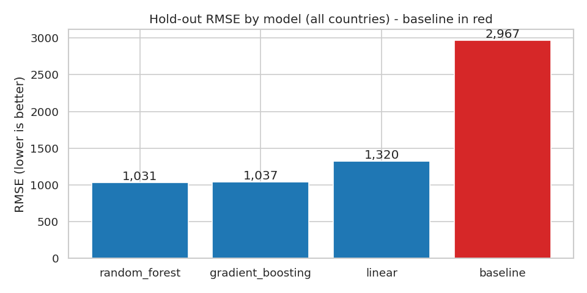
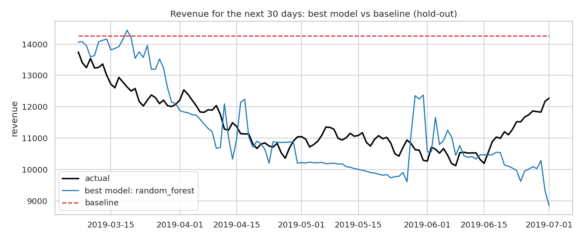
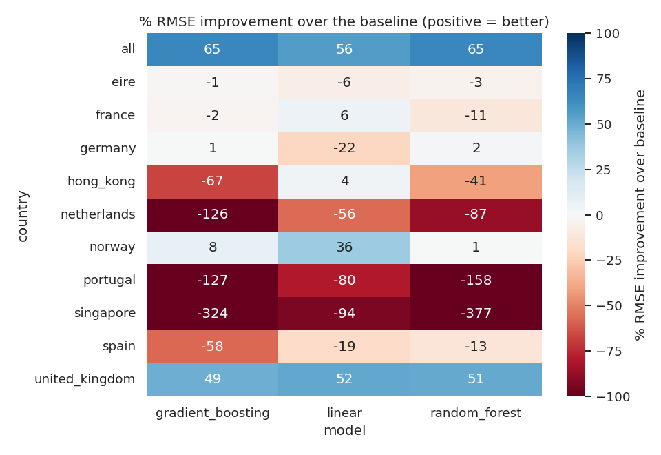
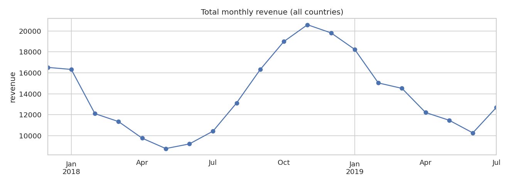
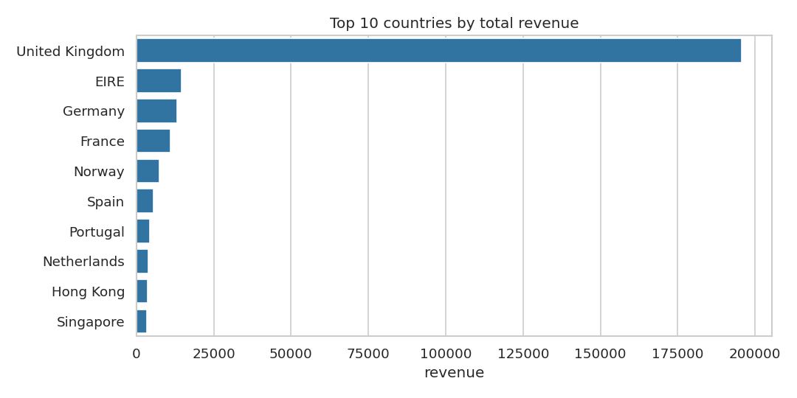
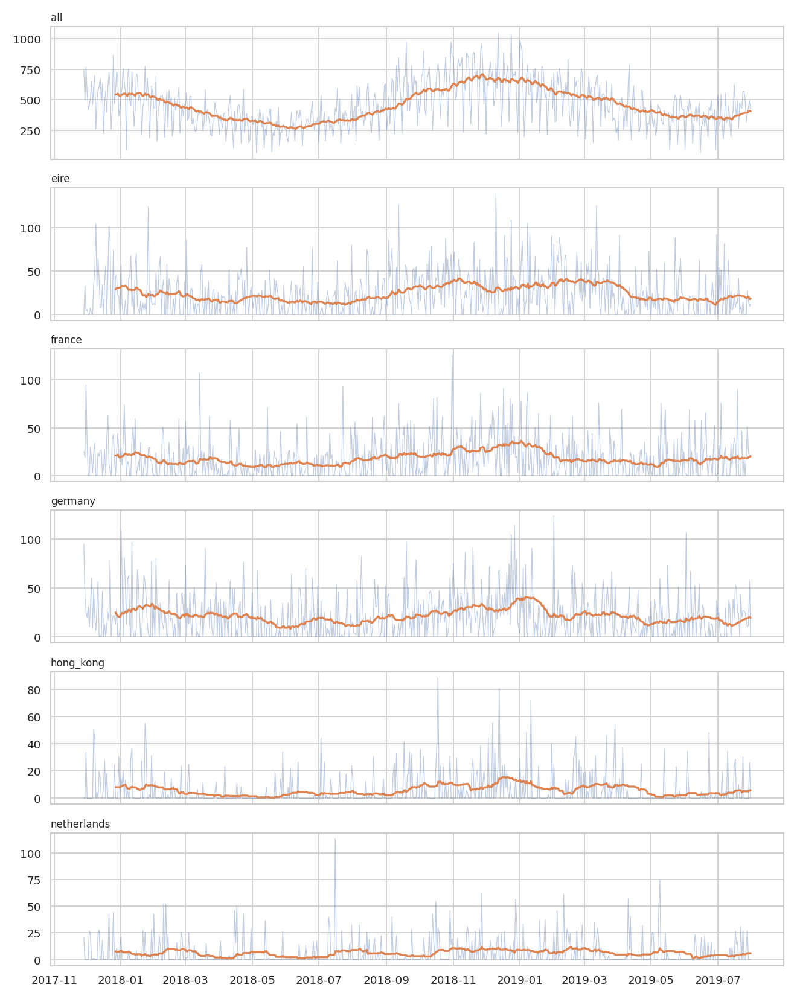
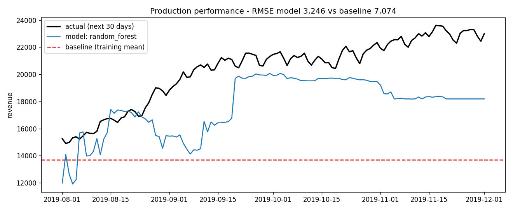

# AAVAIL Revenue Forecast
### An end-to-end AI workflow for predicting next-month revenue by country

*Short title: **AAVAIL Revenue Forecast***

Predicts the revenue for the **next 30 days** for any of the top 10 countries
or for **all countries combined**, served through a Flask API inside a Docker
container, with unit tests, logging and post-production monitoring.

**Automated proof:** every push runs all unit tests, builds the Docker image and
calls the API from inside the running container.
**[See the results on the Actions tab](../../actions)** (green tick = passed).

---

## Reviewer guide – every rubric question, with evidence

You don't need to run anything: each row links to the code **and** to saved
output that shows it working.

| # | Rubric question | Answer | Code | Evidence (open this) |
|---|---|---|---|---|
| 1 | Unit tests for the API? | **Yes** – 12 tests | [unittests/ApiTests.py](unittests/ApiTests.py) | [test_results.txt](reports/evidence/test_results.txt) |
| 2 | Unit tests for the model? | **Yes** – 10 tests | [unittests/ModelTests.py](unittests/ModelTests.py) | [test_results.txt](reports/evidence/test_results.txt) |
| 3 | Unit tests for the logging? | **Yes** – 7 tests | [unittests/LoggerTests.py](unittests/LoggerTests.py) | [test_results.txt](reports/evidence/test_results.txt) |
| 4 | All tests run with one script and pass? | **Yes** – `python run-tests.py` → 29 tests, OK | [run-tests.py](run-tests.py) | [test_results.txt](reports/evidence/test_results.txt), [Actions tab](../../actions) |
| 5 | Mechanism to monitor performance? | **Yes** – drift detection, production RMSE vs training RMSE vs baseline, log summary, `GET /monitor` | [monitoring.py](monitoring.py), [logger.py](logger.py), [logs/](logs) | [monitoring_report.txt](reports/evidence/monitoring_report.txt), [chart](reports/figures/production_performance.png) |
| 6 | Tests isolated from production models and logs? | **Yes** – tests write only to `models/test/` and `logs/test/`, and two tests check production files are untouched | [model.py](model.py) (`test=True`), [logger.py](logger.py) | `test_02_production_models_untouched`, `test_06_production_logs_untouched` in [test_results.txt](reports/evidence/test_results.txt) |
| 7 | API predicts for one country **and** all countries? | **Yes** – `"country": "all"` or e.g. `"united_kingdom"` | [app.py](app.py) | [api_demo.md](reports/evidence/api_demo.md) (real requests + responses) |
| 8 | Data ingestion as a function/script for automation? | **Yes** – `fetch_data()`, `convert_to_ts()`, `fetch_ts()`, `engineer_features()`; run with `python cslib.py` | [cslib.py](cslib.py) | used by `model.py`, `monitoring.py`, the API, the notebooks and the Docker build |
| 9 | Multiple models compared? | **Yes** – baseline, Ridge, Random Forest, Gradient Boosting (grid search + time-series CV) | [model.py](model.py) (`compare_models`) | [model_comparison.md](reports/evidence/model_comparison.md), [notebook 02](notebooks/02-model-comparison.md) |
| 10 | EDA used visualizations? | **Yes** – 6 charts | [01-EDA.ipynb](notebooks/01-EDA.ipynb) | [01-EDA.md](notebooks/01-EDA.md) (always displays), [reports/figures/](reports/figures) |
| 11 | Everything in a working Docker image? | **Yes** – the build ingests data, trains models, runs all tests, then serves the API | [Dockerfile](Dockerfile), [CI workflow](.github/workflows/ci.yml) | [Actions tab](../../actions) – "docker" job builds, starts the container and gets predictions |
| 12 | Visualization comparing the model to the baseline? | **Yes** – 3 charts | [02-model-comparison.ipynb](notebooks/02-model-comparison.ipynb) | charts below, [02-model-comparison.md](notebooks/02-model-comparison.md) |

> If a `.ipynb` notebook shows "Unable to render" on GitHub, open the `.md`
> version next to it – it contains the same code and charts.

---

## Evidence at a glance

### Model vs baseline (rubric 9 and 12)







### EDA (rubric 10)







More: [weekday pattern](reports/figures/eda_weekday.png),
[correlation heatmap](reports/figures/eda_correlation.png),
[revenue distribution](reports/figures/eda_revenue_distribution.png).

### API working for all countries and for one country (rubric 7)

```text
POST /predict  {"query": {"country": "all", "year": "2019", "month": "07", "day": "01"}}
-> 200 {"country": "all", "target_date": "2019-07-01", "y_pred": [11682.64], "y_proba": null}

POST /predict  {"query": {"country": "united_kingdom", "year": "2019", "month": "07", "day": "01"}}
-> 200 {"country": "united_kingdom", "target_date": "2019-07-01", "y_pred": [7382.39], "y_proba": null}
```
Full output: [reports/evidence/api_demo.md](reports/evidence/api_demo.md)

### All unit tests pass with one script (rubric 1–4, 6)

```text
$ python run-tests.py
.............................
Ran 29 tests

OK
```
Full output: [reports/evidence/test_results.txt](reports/evidence/test_results.txt)

### Monitoring (rubric 5)



Full report: [reports/evidence/monitoring_report.txt](reports/evidence/monitoring_report.txt)

---

## Project structure

```
.
├── app.py                  # Flask API (/train, /predict, /logs, /monitor)
├── cslib.py                # data ingestion + time-series feature engineering
├── model.py                # model comparison, training, loading, prediction
├── logger.py               # train / predict logging
├── monitoring.py           # drift + performance monitoring
├── run-tests.py            # runs ALL unit tests with one command
├── Dockerfile
├── requirements.txt
├── .github/workflows/ci.yml  # automatic tests + Docker build on every push
├── data/
│   ├── cs-train/           # training data (monthly JSON invoice files)
│   └── cs-production/      # "production" data used for monitoring
├── models/                 # saved models + model_comparison.csv
│   └── test/               # models created by unit tests (isolated)
├── logs/                   # production logs
│   └── test/               # logs created by unit tests (isolated)
├── notebooks/              # EDA + model comparison (.ipynb and .md)
├── reports/
│   ├── figures/            # all charts
│   └── evidence/           # saved output of tests, API, monitoring
├── scripts/
│   ├── generate_sample_data.py
│   ├── build_notebooks.py
│   └── generate_evidence.py
└── unittests/
    ├── ApiTests.py
    ├── ModelTests.py
    └── LoggerTests.py
```

## How to run

### With Docker

```bash
docker build -t aavail-revenue-forecast .
docker run -p 8080:8080 aavail-revenue-forecast
```

### Without Docker

```bash
python -m venv venv && source venv/bin/activate   # Windows: venv\Scripts\activate
pip install -r requirements.txt
python run-tests.py      # run all unit tests
python app.py            # start the API on http://localhost:8080
```

Models are trained automatically the first time the API needs them. To
retrain explicitly, run `python model.py`.

### Calling the API

```bash
# all countries combined
curl -X POST http://localhost:8080/predict -H "Content-Type: application/json" \
     -d '{"query": {"country": "all", "year": "2019", "month": "07", "day": "01"}}'

# one country
curl -X POST http://localhost:8080/predict -H "Content-Type: application/json" \
     -d '{"query": {"country": "united_kingdom", "year": "2019", "month": "07", "day": "01"}}'

# retrain ("mode": "test" trains isolated test models instead)
curl -X POST http://localhost:8080/train -H "Content-Type: application/json" -d '{}'

# logs and monitoring
curl http://localhost:8080/logs/train-test.log
curl http://localhost:8080/monitor
```

## About the data

`data/cs-train` and `data/cs-production` hold the monthly invoice JSON files.
To use the official course data, copy it into those folders (replacing the
sample files) and rebuild:

```bash
python cslib.py --clean
python model.py
python monitoring.py
pip install -r requirements-dev.txt && python scripts/build_notebooks.py --execute
python scripts/generate_evidence.py
```

`python scripts/generate_sample_data.py` recreates the sample files.
