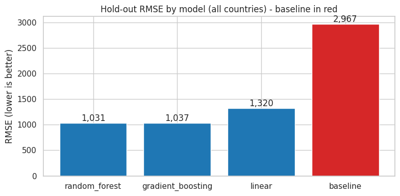
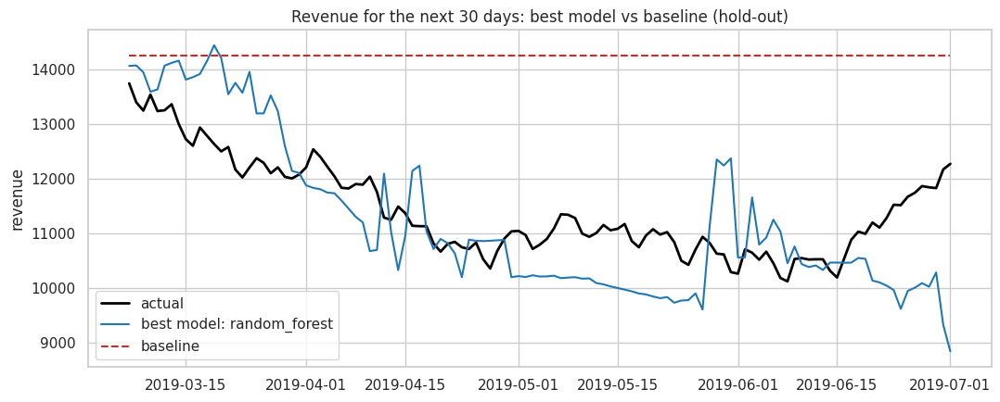
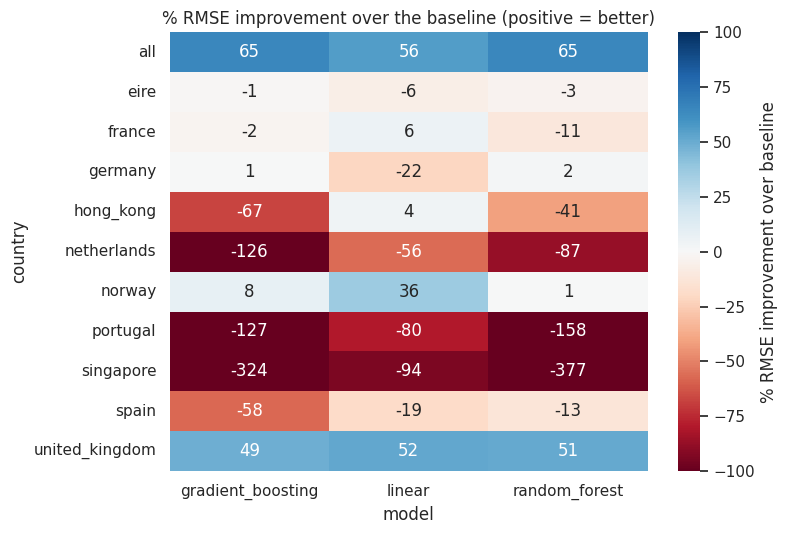

# AAVAIL Revenue Forecast | 02 - Model Comparison vs Baseline

Four models are compared for each time series using a **time-ordered hold-out
set** (the last 20% of days) and grid search with `TimeSeriesSplit`:

| model | description |
|---|---|
| baseline | `DummyRegressor` - always predicts the training mean |
| linear | Ridge regression |
| random_forest | Random forest regressor |
| gradient_boosting | Gradient boosting regressor |

The same code (`model.compare_models`) is used by `model.py` when training
production models, so this notebook reflects exactly what gets deployed.


```python
import os, sys
sys.path.insert(0, os.path.abspath('..'))
import numpy as np
import pandas as pd
import matplotlib.pyplot as plt
import seaborn as sns
sns.set_theme(style='whitegrid')
FIG_DIR = os.path.join('..', 'reports', 'figures')
os.makedirs(FIG_DIR, exist_ok=True)
%matplotlib inline
```


```python
from cslib import fetch_ts, engineer_features, DATA_DIR
from model import compare_models
ts = fetch_ts(DATA_DIR)
X, y, dates = engineer_features(ts['all'], training=True)
print(X.shape)
X.head()
```

    (581, 7)


<div>
<style scoped>
    .dataframe tbody tr th:only-of-type {
        vertical-align: middle;
    }

    .dataframe tbody tr th {
        vertical-align: top;
    }

    .dataframe thead th {
        text-align: right;
    }
</style>
<table border="1" class="dataframe">
  <thead>
    <tr style="text-align: right;">
      <th></th>
      <th>previous_7</th>
      <th>previous_14</th>
      <th>previous_28</th>
      <th>previous_70</th>
      <th>previous_year</th>
      <th>recent_invoices</th>
      <th>recent_views</th>
    </tr>
  </thead>
  <tbody>
    <tr>
      <th>0</th>
      <td>0.00</td>
      <td>0.00</td>
      <td>0.00</td>
      <td>0.00</td>
      <td>0.0</td>
      <td>0.000000</td>
      <td>0.000000</td>
    </tr>
    <tr>
      <th>1</th>
      <td>739.97</td>
      <td>739.97</td>
      <td>739.97</td>
      <td>739.97</td>
      <td>0.0</td>
      <td>41.000000</td>
      <td>2276.000000</td>
    </tr>
    <tr>
      <th>2</th>
      <td>1237.02</td>
      <td>1237.02</td>
      <td>1237.02</td>
      <td>1237.02</td>
      <td>0.0</td>
      <td>37.000000</td>
      <td>2053.000000</td>
    </tr>
    <tr>
      <th>3</th>
      <td>2003.09</td>
      <td>2003.09</td>
      <td>2003.09</td>
      <td>2003.09</td>
      <td>0.0</td>
      <td>39.333333</td>
      <td>2225.666667</td>
    </tr>
    <tr>
      <th>4</th>
      <td>2567.69</td>
      <td>2567.69</td>
      <td>2567.69</td>
      <td>2567.69</td>
      <td>0.0</td>
      <td>39.000000</td>
      <td>2144.250000</td>
    </tr>
  </tbody>
</table>
</div>


## 1. Compare models on all countries combined


```python
results, fitted = compare_models(X, y)
results
```


<div>
<style scoped>
    .dataframe tbody tr th:only-of-type {
        vertical-align: middle;
    }

    .dataframe tbody tr th {
        vertical-align: top;
    }

    .dataframe thead th {
        text-align: right;
    }
</style>
<table border="1" class="dataframe">
  <thead>
    <tr style="text-align: right;">
      <th></th>
      <th>model</th>
      <th>rmse</th>
      <th>mae</th>
      <th>best_params</th>
    </tr>
  </thead>
  <tbody>
    <tr>
      <th>0</th>
      <td>random_forest</td>
      <td>1030.688338</td>
      <td>838.853876</td>
      <td>{'reg__max_depth': None, 'reg__n_estimators': ...</td>
    </tr>
    <tr>
      <th>1</th>
      <td>gradient_boosting</td>
      <td>1036.934958</td>
      <td>814.681954</td>
      <td>{'reg__learning_rate': 0.1, 'reg__n_estimators...</td>
    </tr>
    <tr>
      <th>2</th>
      <td>linear</td>
      <td>1320.042500</td>
      <td>1069.809568</td>
      <td>{'reg__alpha': 10.0}</td>
    </tr>
    <tr>
      <th>3</th>
      <td>baseline</td>
      <td>2967.070381</td>
      <td>2840.147338</td>
      <td>{}</td>
    </tr>
  </tbody>
</table>
</div>


## 2. Visual comparison against the baseline (RMSE)


```python
colors = ['tab:red' if m == 'baseline' else 'tab:blue' for m in results['model']]
fig, ax = plt.subplots(figsize=(8, 4))
ax.bar(results['model'], results['rmse'], color=colors)
for i, v in enumerate(results['rmse']):
    ax.text(i, v, f'{v:,.0f}', ha='center', va='bottom')
ax.set_title('Hold-out RMSE by model (all countries) - baseline in red')
ax.set_ylabel('RMSE (lower is better)')
fig.tight_layout(); fig.savefig(os.path.join(FIG_DIR, 'model_vs_baseline_rmse.png'), dpi=120)
plt.show()
```


    

    


## 3. Predictions vs actual on the hold-out period


```python
split = int(len(X) * 0.8)
X_test, y_test, d_test = X.iloc[split:], y[split:], dates[split:]
best_name = results.loc[0, 'model']
fig, ax = plt.subplots(figsize=(11, 4.5))
ax.plot(d_test, y_test, color='black', lw=2, label='actual')
ax.plot(d_test, fitted[best_name].predict(X_test), color='tab:blue', label=f'best model: {best_name}')
ax.plot(d_test, fitted['baseline'].predict(X_test), color='tab:red', ls='--', label='baseline')
ax.set_title('Revenue for the next 30 days: best model vs baseline (hold-out)')
ax.set_ylabel('revenue'); ax.legend()
fig.tight_layout(); fig.savefig(os.path.join(FIG_DIR, 'model_vs_baseline_holdout.png'), dpi=120)
plt.show()
```


    

    


## 4. Improvement over the baseline for every country

Read from `models/model_comparison.csv`, written by `python model.py`.


```python
comp = pd.read_csv(os.path.join('..', 'models', 'model_comparison.csv'))
pivot = comp.pivot(index='country', columns='model', values='rmse')
improvement = (1 - pivot.div(pivot['baseline'], axis=0)).drop(columns='baseline') * 100
fig, ax = plt.subplots(figsize=(8, 5.5))
sns.heatmap(improvement, annot=True, fmt='.0f', cmap='RdBu', center=0, vmin=-100, vmax=100, ax=ax,
            cbar_kws={'label': '% RMSE improvement over baseline'})
ax.set_title('% RMSE improvement over the baseline (positive = better)')
fig.tight_layout(); fig.savefig(os.path.join(FIG_DIR, 'model_vs_baseline_by_country.png'), dpi=120)
plt.show()
comp.sort_values('rmse').groupby('country').first()[['model', 'rmse']]
```


    

    


<div>
<style scoped>
    .dataframe tbody tr th:only-of-type {
        vertical-align: middle;
    }

    .dataframe tbody tr th {
        vertical-align: top;
    }

    .dataframe thead th {
        text-align: right;
    }
</style>
<table border="1" class="dataframe">
  <thead>
    <tr style="text-align: right;">
      <th></th>
      <th>model</th>
      <th>rmse</th>
    </tr>
    <tr>
      <th>country</th>
      <th></th>
      <th></th>
    </tr>
  </thead>
  <tbody>
    <tr>
      <th>all</th>
      <td>random_forest</td>
      <td>1030.688338</td>
    </tr>
    <tr>
      <th>eire</th>
      <td>baseline</td>
      <td>234.530731</td>
    </tr>
    <tr>
      <th>france</th>
      <td>linear</td>
      <td>113.489928</td>
    </tr>
    <tr>
      <th>germany</th>
      <td>random_forest</td>
      <td>186.751167</td>
    </tr>
    <tr>
      <th>hong_kong</th>
      <td>linear</td>
      <td>90.620290</td>
    </tr>
    <tr>
      <th>netherlands</th>
      <td>baseline</td>
      <td>70.452907</td>
    </tr>
    <tr>
      <th>norway</th>
      <td>linear</td>
      <td>108.075114</td>
    </tr>
    <tr>
      <th>portugal</th>
      <td>baseline</td>
      <td>78.452813</td>
    </tr>
    <tr>
      <th>singapore</th>
      <td>baseline</td>
      <td>40.734055</td>
    </tr>
    <tr>
      <th>spain</th>
      <td>baseline</td>
      <td>69.180228</td>
    </tr>
    <tr>
      <th>united_kingdom</th>
      <td>linear</td>
      <td>947.643262</td>
    </tr>
  </tbody>
</table>
</div>


## 5. Conclusions

* For all countries combined and for the largest country, the tree-based /
  linear models clearly beat the baseline; this supports the hypothesis from
  the EDA.
* For small countries with very noisy revenue, the baseline is sometimes the
  best choice. Because `model.py` always selects the model with the lowest
  hold-out RMSE, the deployed model for those countries is never worse than
  the baseline.
* Post-production, `monitoring.py` checks for data drift and compares the
  production RMSE with the training RMSE and the baseline.
